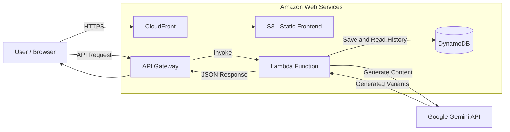

# Ad Creative Generator — System Architecture

## 1. Project Overview

Ad Creative Generator is a cloud-based application that uses artificial intelligence to generate advertising content.

The application allows users to enter a product description, target audience, campaign goal, tone, platform, and additional constraints.

The system processes the brief using Google Gemini API and generates several advertising text variants.

Each request and its generated results are stored in Amazon DynamoDB so users can access their previous generations.

### Main Project Technologies

* Cloud Provider: Amazon Web Services (AWS)
* Infrastructure as Code: Terraform
* AI Model: Google Gemini API
* Frontend Hosting: Amazon S3
* Content Delivery: Amazon CloudFront
* API Management: Amazon API Gateway
* Backend Processing: AWS Lambda
* Database: Amazon DynamoDB
* Region: us-east-1

---

## 2. System Architecture

The application uses a serverless cloud architecture.

The system consists of a frontend, backend processing layer, database, and external AI service.

### Architecture Diagram



### Architecture Components

| Component          | Responsibility                                                                             |
| ------------------ | ------------------------------------------------------------------------------------------ |
| Amazon S3          | Stores the static frontend files.                                                          |
| Amazon CloudFront  | Delivers frontend content through a CDN and supports HTTPS.                                |
| Amazon API Gateway | Receives HTTP requests from the frontend.                                                  |
| AWS Lambda         | Processes user briefs, prepares prompts, calls Gemini API and handles database operations. |
| Amazon DynamoDB    | Stores user briefs and generated advertising variants.                                     |
| Google Gemini API  | Generates advertising content using artificial intelligence.                               |
| Terraform          | Defines and deploys cloud infrastructure.                                                  |

---

## 3. Request Processing Flow

When a user clicks the Generate button, the following process takes place:

1. The user enters advertising information into the frontend form.
2. The browser sends the request to Amazon API Gateway over HTTPS.
3. API Gateway invokes the AWS Lambda function.
4. Lambda validates the input and prepares an AI prompt.
5. Lambda retrieves the Gemini API key from AWS Systems Manager Parameter Store.
6. Lambda sends the prompt to Google Gemini API.
7. Gemini generates advertising text variants.
8. Lambda saves the brief and generated results in DynamoDB.
9. The generated content is returned to the frontend as a JSON response.
10. The frontend displays the advertising variants to the user.

---

## 4. Network Architecture

The project uses AWS networking components to organize and secure cloud infrastructure.

The planned network configuration includes:

* Amazon VPC for network isolation.
* Two subnets in different Availability Zones.
* Security Groups to control network traffic.
* DynamoDB Gateway VPC Endpoint for private connectivity to DynamoDB from resources inside the VPC.

### NAT Gateway Considerations

A NAT Gateway allows resources in private subnets to access the internet.

However, NAT Gateway introduces additional hourly and data processing costs.

To reduce project expenses, the Lambda function is planned to operate outside the VPC.

This allows Lambda to access external services such as Google Gemini API without requiring a NAT Gateway.

The VPC and its networking components are documented as part of the infrastructure design.

**Note:** The final VPC attachment and endpoint configuration must be confirmed against the actual Terraform implementation.

---

## 5. API Contract

The API contract defines how the frontend and backend communicate.

Both components must follow the same request and response structure.

### 5.1 POST /generate

Purpose: Generate advertising content based on the user's brief.

Request:

```json
{
  "product": "Coffee",
  "audience": "Young people",
  "goal": "Increase sales",
  "tone": "Friendly",
  "platform": "Instagram",
  "constraints": "Short text"
}
```

Successful Response:

```json
{
  "requestId": "12345",
  "createdAt": "2026-11-02T12:00:00Z",
  "variants": [
    {
      "headline": "Start your day with coffee!",
      "subheadline": "Fresh energy every morning",
      "bullets": [
        "Natural ingredients",
        "Great taste"
      ],
      "cta": "Order now"
    }
  ]
}
```

### 5.2 GET /history?limit=20

Purpose: Retrieve previously generated advertising content.

Response:

```json
{
  "items": [
    {
      "requestId": "12345",
      "createdAt": "2026-11-02T12:00:00Z",
      "product": "Coffee",
      "variants": []
    }
  ]
}
```

### 5.3 Error Response

If the request contains invalid or missing information, the API returns an error.

Example:

```json
{
  "error": {
    "code": "VALIDATION_ERROR",
    "message": "Product field is required"
  }
}
```

### API Endpoints Summary

| Method | Endpoint          | Description                    |
| ------ | ----------------- | ------------------------------ |
| POST   | /generate         | Generates advertising content. |
| GET    | /history?limit=20 | Retrieves generation history.  |

The backend and frontend teams must use this contract during development.

---

## 6. Security Considerations

Security is an important part of the project architecture.

The following measures are planned:

* HTTPS is used for secure communication.
* IAM roles provide controlled access to AWS resources.
* Lambda receives only the permissions required for its tasks.
* Gemini API keys are stored securely in AWS Systems Manager Parameter Store.
* Sensitive information must not be committed to GitHub.
* S3 frontend storage should not expose private infrastructure files.
* Terraform state must be stored in a protected S3 bucket.

The project follows the principle of least privilege.

---

## 7. Infrastructure Management

Terraform is used to define and manage AWS infrastructure.

All main infrastructure resources are described as code.

This approach provides:

* Repeatable deployments.
* Consistent infrastructure configuration.
* Easier collaboration between team members.
* Better infrastructure management.

The Terraform state is stored remotely in Amazon S3, with DynamoDB-based state locking according to the team's infrastructure plan.

---

## 8. Conclusion

Ad Creative Generator uses AWS serverless services and Google Gemini API to automate advertising content generation.

The architecture separates frontend presentation, backend processing, database storage, and AI generation.

Terraform provides repeatable infrastructure deployment, while IAM and secure parameter storage help protect the application.

This architecture is designed to support a small academic project while keeping infrastructure simple and cost-efficient.
